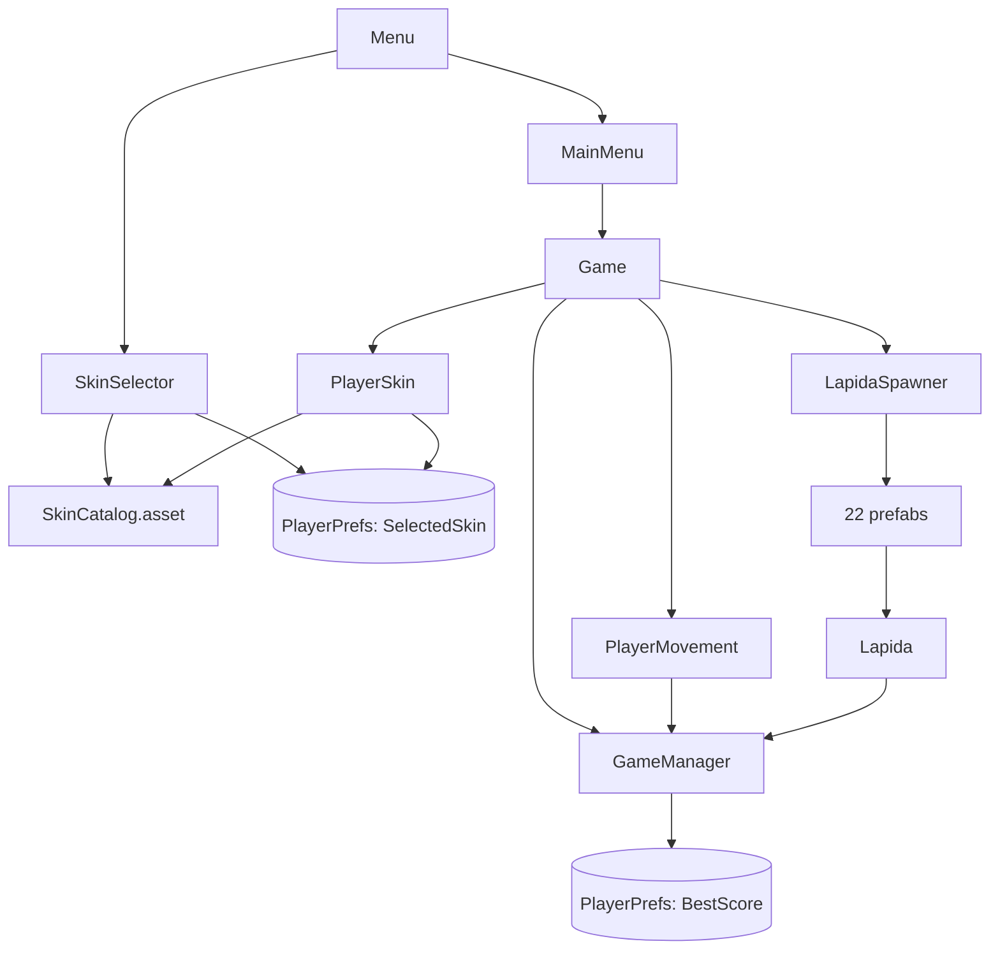

# Documentación técnica de Escape Calaverita

> Estado documentado: 20 de octubre de 2026. Esta guía describe el contenido y las referencias serializadas actuales del proyecto.

## 1. Resumen

**Escape Calaverita** es un juego 2D inspirado en *Flappy Bird*. El jugador controla una calaverita que debe atravesar huecos entre lápidas que avanzan de derecha a izquierda.

Incluye un menú, selector con 11 skins persistentes, pantalla de espera, HUD, Game Over, 22 combinaciones de obstáculos, dificultad progresiva, récord persistente, entrada para teclado/ratón/toque, música y efectos de muerte.

## 2. Requisitos y configuración

| Elemento | Valor actual |
| --- | --- |
| Unity | `6000.6.0f1` |
| Renderizado | Universal Render Pipeline 2D 17.6.0 |
| Entrada | Input System 1.20.0 |
| UI | Unity UI 2.6.0 y TextMesh Pro |
| Física | Physics 2D; gravedad global `(0, -9.81)` |
| Resolución predeterminada | `1920 × 1080` |
| Color | Linear |
| Producto | `Escape Calaverita`, versión `1.0` |
| Primera escena | `Assets/Scenes/Menu.unity` |

Para abrirlo: clonar, ejecutar `git lfs pull`, abrir la raíz con Unity Hub y esperar la restauración de paquetes. Las carpetas `Library`, `Temp`, `Logs`, `UserSettings`, `obj` y `Builds` son locales y están ignoradas.

## 3. Arquitectura



Las dependencias se resuelven con referencias del Inspector, `GameManager.Instance`, una búsqueda puntual de `PlayerMovement` y `PlayerPrefs`. El manager no usa `DontDestroyOnLoad`.

## 4. Flujo de ejecución

1. El build abre `Menu`.
2. `MainMenu.Awake()` conecta navegación y muestra `MenuPrincipal`.
3. `SkinSelector.Awake()` carga `SelectedSkin`, actualiza la vista previa y conecta anterior/siguiente.
4. **Jugar** carga `Game`.
5. `GameManager.Awake()` recupera el récord, restaura el tiempo y configura paneles.
6. `PlayerSkin.Awake()` aplica y normaliza la skin seleccionada.
7. `PlayerMovement.Awake()` reduce la hitbox, desactiva temporalmente la física y limpia partículas.
8. `LapidaSpawner.Start()` crea un obstáculo inmediato, quieto hasta comenzar.
9. La primera acción oculta `StartPanel`, muestra el HUD, activa la física y salta.
10. Los obstáculos avanzan; al pasar la X del jugador suman un punto.
11. Colisionar o salir verticalmente de la cámara provoca la muerte.
12. Se ocultan sprite/collider, se reproducen efectos, aparece Game Over y el tiempo se pausa.
13. Tras 0.5 s no escalados se habilitan botones. Reintentar recarga e inicia directamente; Menú vuelve a `Menu`.

## 5. Escenas

### 5.1 `Assets/Scenes/Menu.unity`

Escena 0 y primera del build.

```text
Menu
├── Main Camera
├── Background
├── MusicManager
├── MainMenu
├── Canvas
│   ├── MenuPrincipal
│   │   ├── Titulo
│   │   ├── BotonJugar
│   │   └── BotonSkins
│   └── SkinPanel [inactivo inicialmente]
│       ├── Titulo
│       ├── FondoSkinPreview
│       ├── SkinPreview
│       ├── NombreSkin
│       ├── BotonAnterior/Image
│       ├── BotonSiguiente/Image
│       └── BotonVolver/{Image, Text}
└── EventSystem
```

| Objeto | Función/configuración |
| --- | --- |
| `Main Camera` | Ortográfica, tamaño `5`, posición `(0,0,-10)`, AudioListener y datos URP. |
| `Background` | `fondo.jpg`, posición cero, escala `(4,3,1)`. |
| `MusicManager` | `Menu-Theme_LOOP.mp3`, volumen `0.4`, loop y Play On Awake. |
| `MainMenu` | Script y referencias a ambos paneles, botón Skins y botón Volver. |
| `Canvas` | Screen Space Overlay; Scale With Screen Size `1920×1080`, match `0.5`. |
| `MenuPrincipal` | Panel transparente con título y botones. |
| `SkinPanel` | Panel transparente con `SkinSelector`; comienza inactivo. |
| `EventSystem` | UI mediante `InputSystemUIInputModule`. |

`BotonJugar` tiene una llamada persistente a `MainMenu.Play()`. Skins/Volver y Anterior/Siguiente se conectan desde código y se desconectan en `OnDestroy()`.

### 5.2 `Assets/Scenes/Game.unity`

Escena 1 y núcleo jugable.

```text
Game
├── Main Camera
├── Background
├── Player
│   └── PlayerVisual
├── SpawnPoint
├── GroundPoint
├── LapidaSpawner
├── Ground
├── GameManager
├── MusicManager
├── Canvas
│   ├── StartPanel/{TituloJugar, Indicacion1, Indicacion2}
│   ├── HUDPanel/Puntos
│   └── GameOverPanel
│       ├── TituloGameOver
│       ├── Puntos
│       ├── Record
│       ├── Boton_Reintentar
│       └── Boton_Menu
├── EventSystem
└── Explosion
```

| Objeto | Función/configuración |
| --- | --- |
| `Main Camera` | Ortográfica, tamaño `5`, posición `(0,0,-10)`. Define límites, spawn y despawn. |
| `Background` | `fondo.jpg`, escala `(4,3,1)`. |
| `Player` | Posición `(-3.63,0.32,0)`, escala `0.1444`, Rigidbody2D, PolygonCollider2D, movimiento y skin. |
| `PlayerVisual` | Hijo con SpriteRenderer; se escala sin afectar el collider del padre. |
| `SpawnPoint` | `(12.87,-3.48,0)`; solo se consulta su X y puede limitarse por la cámara. |
| `Ground` | `(-2.86,-6.53,0)`, escala `(20,1,1)`, BoxCollider2D trigger, tag `Obstacle`. |
| `GroundPoint` | `(-12.74,-4.95,0)`; actualmente ningún script lo utiliza. |
| `LapidaSpawner` | Script con las 22 referencias de obstáculos. |
| `MusicManager` | `Suspense_1_LOOP.mp3`, volumen `1`, loop. |

El Rigidbody del jugador es dinámico, Gravity Scale `2.5` y colisión continua. El PolygonCollider es trigger y se reduce a 78 % en `Awake`.

El Canvas es Screen Space Overlay, pero está en **Constant Pixel Size**, distinto del menú. `StartPanel` y `HUDPanel` tienen fondo transparente. `GameOverPanel` usa negro con alpha `0.39215687`, oscureciendo aproximadamente 39 %. Aunque StartPanel está guardado inactivo, `GameManager` lo activa al iniciar normalmente. Los botones finales se conectan desde código.

### 5.3 Escenas auxiliares

- `Assets/Scenes/SampleScene.unity`: cámara, Global Light 2D, Player y Lapida de prueba. No está en el build.
- `Assets/_Recovery/0.unity`: recuperación del editor; no es producción.
- `Assets/Settings/Scenes/URP2DSceneTemplate.unity`: plantilla URP; no está en el build.

## 6. Scripts en detalle

### 6.1 `GameManager.cs`

Administra estado, UI, puntos, récord y escenas.

**Estado público:** `Instance`, `IsGameStarted`, `IsGameOver`, `Score` y `BestScore`; todos salvo el singleton tienen setter privado.

**Referencias:** `startPanel`, `hudPanel`, `scoreText`, `gameOverPanel`, `pointsText`, `recordText`, `restartButton` y `menuButton`.

**`Awake()`** destruye duplicados, asigna el singleton, fuerza `Time.timeScale = 1`, lee `BestScore`, consume `startImmediatelyAfterReload` y configura la interfaz. La bandera estática sobrevive a la recarga de escena y hace que Reintentar omita la pantalla inicial.

**`StartGame()`** ignora estados inválidos; marca el inicio, oculta StartPanel y muestra HUD.

**`WasActionPressed()`** acepta espacio, flecha arriba, `W`, clic izquierdo o toque primario; valida que cada dispositivo exista.

**`AddScore()`** solo opera jugando: aumenta Score, actualiza el texto y, si hay récord, escribe `BestScore` en PlayerPrefs y guarda inmediatamente.

**`GameOver()`** es idempotente. Guarda `Time.unscaledTime`, oculta HUD, actualiza/activa Game Over y pone `Time.timeScale = 0`.

**`Update()`** espera 0.5 segundos no escalados, habilita botones y permite reiniciar con espacio, Enter o Enter numérico.

**Escenas:** `RestartGame()` activa inicio inmediato y recarga el índice actual; `LoadMainMenu()` restaura el tiempo y carga `Menu`.

### 6.2 `PlayerMovement.cs`

Controla física, salto, inclinación, límites, hitbox y muerte.

| Campo | Valor |
| --- | ---: |
| `jumpForce` | `6` |
| `fallSpeedLimit` | `-9` |
| `rotationSpeed` | `8` |
| `hitboxScale` | `0.78` |
| `deathSoundVolume` | `0.75` |

`Awake()` obtiene componentes, multiplica todos los puntos del PolygonCollider por `0.78`, almacena cámara/renderer, desactiva `rb.simulated` y limpia la explosión. `Start()` detecta el reintento directo, activa física y salta.

En `Update()`, una acción inicia si hace falta y llama `Jump()`. El salto **reemplaza** la velocidad Y por `6`; no suma fuerza. La caída se limita con `max(velocityY, -9)`. La velocidad vertical se remapea de `[-9,6]` a una rotación `[-75°,30°]`, interpolada mediante `rotationSpeed`.

`Die()` puede venir de trigger, colisión sólida o límites verticales. `isDead` evita repetición; reproduce efectos, oculta el hijo visual, desactiva collider, detiene velocidad y llama `GameManager.GameOver()`.

La explosión se mueve al jugador, se limpia y reproduce. `AudioSource.PlayClipAtPoint` crea el impacto en la posición de la cámara para mantener claridad 2D.

### 6.3 `LapidaSpawner.cs`

Genera obstáculos y dificultad.

| Campo serializado en Game | Valor |
| --- | ---: |
| Prefabs | `22` |
| `minGapY / maxGapY` | `-1.25 / 1.25` |
| `minScale / maxScale` | `1 / 1` |
| `minSpacing / maxSpacing` | `5 / 6.5` |
| `startSpeed / maxSpeed` | `3 / 5` |
| `speedIncreasePerSecond` | `0.035` |

Aunque el script declara escalas predeterminadas `0.94–1.02`, la escena las sobrescribe con `1–1`.

`Start()` fija la velocidad, sortea la siguiente separación y crea la primera lápida. `Update()` solo trabaja durante juego activo. La velocidad usa `MoveTowards`; tarda unos `57.14 s` en llegar de 3 a 5.

El spawn es por distancia:

```text
travelled += Speed × deltaTime
spawn si travelled >= nextSpacing
```

Así la distancia visual se conserva aunque disminuya el tiempo entre obstáculos.

`Spawn()` elige uniformemente, calcula `spawnX = min(SpawnPoint.x, cameraRight + 1.5)`, instancia, renombra, escala y coloca el hueco con:

```text
positionY = random(minGapY,maxGapY) - gapCenterLocal × lossyScaleY
```

Los prefabs actuales usan `gapCenterLocal = 0`, así que su Y coincide con el centro sorteado.

### 6.4 `Lapida.cs`

`[RequireComponent(Rigidbody2D)]`. `Speed` es estática y compartida. `Awake()` obtiene el rigidbody y prueba el sistema procedural de collider. `Start()` calcula el despawn en borde izquierdo menos 3 y encuentra al jugador.

`FixedUpdate()` mantiene velocidad cero antes/después de jugar; durante la partida asigna `Vector2.left * Speed`. `Update()` suma un punto una sola vez al pasar la X del jugador y destruye la instancia fuera de cámara.

Hay dos estrategias de collider:

- **Prefabs modernos:** padre sin SpriteRenderer y dos hijos con BoxCollider2D trigger. `ConfigureGapColliders()` sale inmediatamente y respeta las cajas manuales.
- **Prefab antiguo:** sprite y polígono en la raíz. El método reutiliza/agrega PolygonCollider2D, desactiva otros colliders y construye dos paths alrededor de un hueco definido por `gapCenterLocal`, `gapHeightLocal`, `colliderWidth` y `openingColliderWidth`.

### 6.5 `MainMenu.cs`

`Awake()` conecta Skins y Volver y siempre llama `CloseSkinPanel()`. `Play()` restaura el tiempo y carga el nombre serializado `Game`. `OpenSkinPanel()` y `CloseSkinPanel()` alternan los paneles. `OnDestroy()` elimina listeners.

### 6.6 `SkinCatalog.cs`

ScriptableObject con arreglo de `Skin`; cada entrada guarda `displayName` y `sprite`.

- `Count`: cantidad segura ante null.
- `GetSkin()`: devuelve null si está vacío y limita el índice.
- `ClampIndex()`: corrige preferencias antiguas.
- `GetScaleRelativeToFirstSkin()`: devuelve `anchoReferencia / anchoSeleccionado` con validaciones.

La primera entrada es la referencia visual. La clave compartida es `SelectedSkin`.

### 6.7 `SkinSelector.cs`

En `Awake()` conecta botones, lee y limita `SelectedSkin`, y refresca sin volver a guardar. Anterior/Siguiente usan aritmética circular. `RefreshSelection()` asigna sprite, activa `preserveAspect`, actualiza nombre, habilita navegación solo con más de una entrada y guarda inmediatamente si el usuario cambió la selección. No existe botón Confirmar.

### 6.8 `PlayerSkin.cs`

Localiza el SpriteRenderer hijo si falta la referencia, conserva su escala original y aplica la preferencia. Asigna sprite, calcula escala relativa al ancho de la primera skin y multiplica X/Y del hijo. El Player, Rigidbody y collider no cambian. También corrige PlayerPrefs si el índice guardado dejó de existir.

## 7. Skins

| # | Nombre | Archivo | Resolución |
| ---: | --- | --- | ---: |
| 0 | CALAVERITA CLASICA | `calaverita.png` | 1450×1626 |
| 1 | CALAVERITA DE CEMPASÚCHIL | `calaverita_cempasuchil.png` | 480×427 |
| 2 | CALAVERITA NOCTURNA | `calaverita_nocturna.png` | 472×422 |
| 3 | CALAVERITA MARIACHI | `calaverita_mariachi.png` | 516×417 |
| 4 | CALAVERITA LUCHADORA | `calaverita_luchadora.png` | 391×439 |
| 5 | CALAVERITA AZTECA | `calaverita_azteca.png` | 409×458 |
| 6 | CALAVERITA EMBRUJADA | `calaverita_embrujada.png` | 403×434 |
| 7 | CALAVERITA DULCE | `calaverita_dulce.png` | 494×432 |
| 8 | CALAVERITA REVOLUCIONARIA | `calaverita_revolucionaria.png` | 496×434 |
| 9 | CALAVERITA DE HIELO | `calaverita_hielo.png` | 475×417 |
| 10 | CALAVERITA CATRINA | `calaverita_catrina.png` | 514×442 |

Están en `Assets/Material/Sprites/Skins`, Sprite Single, 100 PPU y filtro Point. Para agregar otra: importar PNG transparente, configurar igual, aumentar el arreglo de `SkinCatalog.asset`, llenar nombre/sprite y conservar la clásica en índice 0 si debe seguir siendo referencia.

## 8. Obstáculos y prefabs

```text
Raíz Lapida_XX_*
├── Rigidbody2D Kinematic
├── Lapida
├── Superior
│   ├── SpriteRenderer
│   └── BoxCollider2D trigger
└── Inferior
    ├── SpriteRenderer
    └── BoxCollider2D trigger
```

Los 22 prefabs modernos usan tag `Obstacle`, `gapCenterLocal=0`, `gapHeightLocal=3.6`, `colliderWidth=0.72` y `openingColliderWidth=0.44`. Las posiciones y cajas de cada hijo fueron ajustadas individualmente.

El spawner registra:

- `Lapida_00_Completa`.
- Para estilos 01–07: `Completa`, `GenericaAbajo` y `GenericaArriba`.

`Completa` combina el mismo estilo. `GenericaAbajo` usa estilo decorado arriba y 00 abajo. `GenericaArriba` usa 00 arriba y estilo decorado abajo. Cada una tiene la misma probabilidad.

`Assets/Prefabs/Lapida.prefab` y `Lapida Variant.prefab` son el sistema antiguo y no están en el arreglo actual.

## 9. Puntuación, dificultad y persistencia

El punto se concede cuando la raíz del obstáculo cruza la X del jugador, sin trigger de puntuación independiente.

| Clave PlayerPrefs | Contenido |
| --- | --- |
| `BestScore` | Récord máximo (`int`). |
| `SelectedSkin` | Índice del catálogo (`int`). |

Balance actual: velocidad `3→5`, incremento `0.035/s`, separación `5–6.5`, centro Y `-1.25–1.25`, escala fija `1`.

## 10. Entrada

| Contexto | Entrada |
| --- | --- |
| Comenzar/volar | Espacio, arriba, `W`, clic izquierdo, toque primario. |
| Reintentar tras 0.5 s | Espacio, Enter, Enter numérico. |
| UI | InputSystemUIInputModule. |

El vuelo consulta dispositivos directamente; no usa una acción con nombre de `InputSystem_Actions.inputactions`. Ese asset permanece asignado para la UI.

## 11. Colisiones

- Player: PolygonCollider2D trigger reducido a 78 %.
- Lápidas modernas: dos BoxCollider2D trigger.
- Ground: BoxCollider2D trigger.
- Peligros: tag obligatorio `Obstacle`.
- Se procesan triggers y colisiones sólidas.
- Salir arriba/abajo también mata.
- La skin nunca cambia la hitbox.

## 12. Audio y partículas

| Recurso | Uso | Volumen |
| --- | --- | ---: |
| `Menu-Theme_LOOP.mp3` | Menú, loop | 0.4 |
| `Suspense_1_LOOP.mp3` | Juego, loop | 1.0 |
| `Heavy Object Impact 4.wav` | Muerte | 0.75 |

No hay music manager persistente; cada escena tiene su AudioSource.

`Explosion`: duración 0.5 s, sin loop/Play On Awake, tiempo no escalado, vida 0.3–0.8 s, velocidad 3–6, tamaño 0.25–0.4, tonos naranja/amarillo, rate 0, burst de 30–50, cono de 25° y arco 360°. Por usar tiempo no escalado sigue visible con `timeScale=0`.

## 13. Assets visuales y fuentes

- `fondo.jpg`: fondo común, filtrado bilinear.
- `titulo_calavera.png`, `titulo_jugar.png`, `titulo_game_over.png`: títulos.
- `boton_jugar.png`, `boton_cambiar_skin.png`, `boton_reintentar.png`, `boton_menu.png`, `boton_avanzar.png`: UI.
- `skin_preview.png`: marco del selector.
- `herencia.jpg`: existe, pero no está referenciado en escenas de producción.
- `lapidas/`: ocho pares superior/inferior, Sprite Single, 100 PPU, Point.
- `Fonts/`: Pixelify Sans Medium/Regular y atlas SDF.
- `TextMesh Pro/`: recursos predeterminados, Liberation Sans, shaders, materiales y reglas de texto.

## 14. Estructura de carpetas

```text
Assets/
├── _Recovery/                 Recuperación de Unity
├── Data/Skins/                SkinCatalog.asset
├── Fonts/                     Pixelify Sans y atlas TMP
├── Material/Sprites/
│   ├── Skins/                 11 skins
│   ├── lapidas/               8 pares de obstáculos
│   └── fondo, títulos y UI
├── Music/                     2 loops y 1 impacto
├── Prefabs/Lapidas/           22 combinaciones modernas
├── Scenes/                    Menu, Game, SampleScene
├── Scripts/                   8 scripts propios
├── Settings/                  URP, Renderer2D, Input y plantillas
├── TextMesh Pro/              Recursos TMP
└── Welcome/                   Recursos de bienvenida de la plantilla
Packages/                      Manifest y lock
ProjectSettings/               Configuración serializada
```

Todo asset debe moverse con su `.meta`; el GUID preserva referencias.

## 15. Build, renderizado y paquetes

Build Settings, en orden: `Menu.unity` y `Game.unity`, ambas habilitadas. `MainMenu` carga `Game`; `GameManager` carga `Menu`, por lo que esos nombres deben mantenerse o actualizarse.

Configuración URP: `UniversalRP.asset`, `Renderer2D.asset`, `UniversalRenderPipelineGlobalSettings.asset`, `DefaultVolumeProfile.asset` y `Lit2DSceneTemplate.scenetemplate`.

Hay paquetes de Animation 2D, Aseprite, PSD Importer, SpriteShape, Tilemap, Visual Scripting, Timeline, Test Framework e IDE. Varios son de la plantilla y no intervienen directamente en la lógica.

## 16. Git y LFS

`.gitattributes` mantiene como texto scripts, escenas, prefabs, YAML y metadatos. Imágenes, audio, fuentes, modelos y video pasan por Git LFS. Ejecutar `git lfs install` por equipo y `git lfs pull` tras clonar. Nunca separar un asset de su `.meta`.

## 17. Extender el proyecto

### Skin nueva

1. PNG transparente en `Assets/Material/Sprites/Skins`.
2. Sprite Single, Point, alpha, sin compresión.
3. Aumentar `SkinCatalog.asset/Skins`.
4. Completar nombre y sprite.
5. Conservar índice 0 como referencia o aceptar el cambio global de tamaño.
6. Probar selector, partida y reintento.

### Lápida nueva

1. Importar superior/inferior en `lapidas`, 100 PPU, Point y alpha.
2. Duplicar prefab moderno.
3. Sustituir sprites y ajustar posiciones.
4. Ajustar ambos BoxCollider2D sin invadir el hueco.
5. Conservar tag, Rigidbody cinemático y `Lapida` en raíz.
6. Mantener `gapCenterLocal=0` si el hueco está centrado.
7. Añadir al arreglo del spawner.

### Balance

- Altura aleatoria: `minGapY/maxGapY`.
- Distancia horizontal: `minSpacing/maxSpacing`.
- Velocidad: `startSpeed/maxSpeed/speedIncreasePerSecond`.
- Vuelo: `jumpForce`, `fallSpeedLimit`, Gravity Scale.
- Hueco físico moderno: posiciones y colliders hijos; `gapHeightLocal` no los reajusta.

## 18. Dependencias y precauciones

- `GameManager` es obligatorio para coordinar Game.
- La primera skin define el ancho de referencia.
- Todo peligro requiere tag `Obstacle`.
- Los obstáculos modernos dependen de colliders hijos.
- `SpawnPoint.y` no controla altura; la Y viene del rango del spawner.
- `SpawnPoint.x` puede limitarse a `cameraRight+1.5`.
- Menu y Game usan CanvasScaler distintos.
- SampleScene, Recovery, GroundPoint, `herencia.jpg` y prefabs antiguos no participan en el flujo principal.
- `projectName` interno puede seguir como `Juego calaverita`; `productName` compilado es `Escape Calaverita`.

## 19. Checklist de prueba

1. Abrir Menu y comprobar MenuPrincipal.
2. Recorrer las 11 skins en ambas direcciones.
3. Elegir una y verificar persistencia/tamaño en Game.
4. Confirmar que no cae antes de la primera acción.
5. Probar teclado, clic y toque.
6. Atravesar una lápida: exactamente un punto.
7. Chocar con superior, inferior, Ground y límites.
8. Revisar explosión, sonido, overlay, puntos y récord.
9. Confirmar espera de 0.5 s de botones.
10. Reintentar: inicio directo sin StartPanel.
11. Volver al menú: skin y récord persisten.
12. Ejecutar build desde Menu y verificar audio, UI y referencias.
